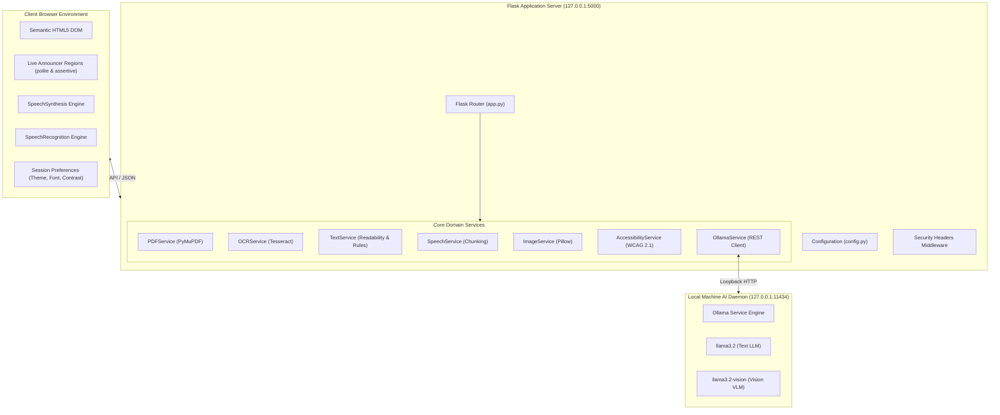
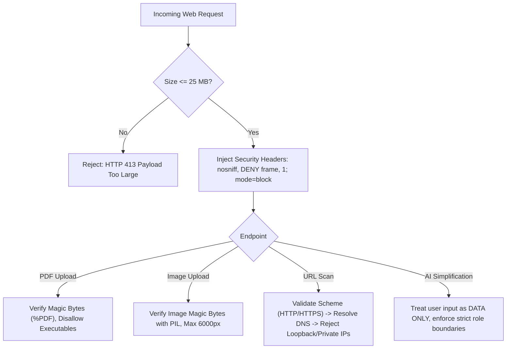

# AccessAble AI — Architecture & Technical Design Document

## 1. System Overview
AccessAble AI is architected as a local-first, modular web application combining a lightweight Flask server with native browser accessibility capabilities and a private Ollama AI inference runtime.

---

## 2. Component Design & Responsibilities

### 2.1 Backend Services
1. **`app.py`:** Application factory and REST routing hub. Dispatches requests to specialized service modules, enforces request payload limits, injects security headers, and formats structured error responses.
2. **`services/pdf_service.py`:** PyMuPDF integration. Ingests raw PDF bytes, validates headers, detects passwords, extracts text on a per-page basis, and executes heuristic scanned-page detection.
3. **`services/ocr_service.py`:** Local Tesseract OCR interface. Renders PDF pages to raster bitmaps via PyMuPDF at 200 DPI and invokes system OCR. Contains Windows installation instructions and fallback handling.
4. **`services/text_service.py`:** Readability scoring and non-AI fallback. Implements Flesch Reading Ease and Flesch-Kincaid Grade Level formulas. Houses plain-English vocabulary dictionaries and sentence-splitting regex routines.
5. **`services/speech_service.py`:** Intelligent sentence chunker for the browser SpeechSynthesis API, segmenting long text at grammatical boundaries to eliminate Chrome/Safari speech timeout truncation.
6. **`services/image_service.py`:** Image validator utilizing Pillow. Validates image headers, rejects corrupted or oversized images, extracts dimensions, and encodes payloads into standard base64 data URIs.
7. **`services/accessibility_service.py`:** WCAG 2.1 auditor. Parses HTML DOM with BeautifulSoup, tests against 11 WCAG rules, computes a weighted accessibility score, and runs multi-hop IP resolution blocklists to prevent SSRF vulnerabilities.
8. **`services/ollama_service.py`:** Dedicated Ollama integration. Communicates with `http://127.0.0.1:11434/api/chat` and `/api/tags`, handles timeouts, prevents prompt injection, and formats structured output for simplification, alt-text, and learning modes.

---

## 3. Security Perimeter & Attack Surface Mitigations

### SSRF Protection Details
The URL scanner implements defense-in-depth against Server-Side Request Forgery:
- Protocol restriction: Only `http://` and `https://` schemes permitted.
- Hostname resolution: All DNS addresses are resolved before connecting.
- IP blocklist: Loopback (`127.0.0.0/8`, `::1`), private ranges (`10.0.0.0/8`, `172.16.0.0/12`, `192.168.0.0/16`), link-local (`169.254.0.0/16`), and carrier-grade NAT (`100.64.0.0/10`) are blocked.
- Redirect protection: HTTP redirects are resolved manually and re-validated at every hop up to 3 hops maximum.
- Response boundaries: Content is read as a capped stream up to 1 MB maximum.

---

## 4. Frontend State & ARIA Architecture
- **State Store:** Centralized client-side state machine tracking theme, font scale, line spacing, model status, and speech synthesis queues.
- **Persistence:** Local preferences synchronized with `localStorage` and immediately reflected in CSS variables.
- **Screen Reader Announcer:** Polymorphic live regions (`#sr-announcer` with `aria-live="polite"` and `#sr-alert` with `aria-live="assertive"`).
- **Focus Management:** Tab panel transitions manage `tabindex="0"` on active elements and `tabindex="-1"` on inactive elements.
